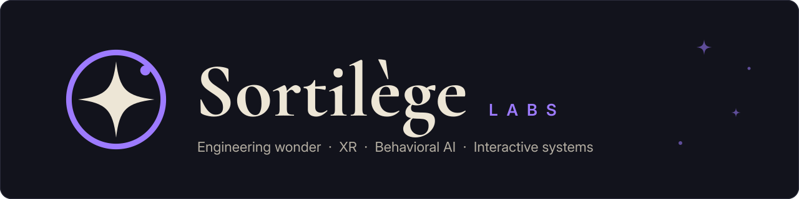

<div align="center">

<picture>
  <source media="(prefers-color-scheme: dark)" srcset="assets/banner-dark.svg">
  <source media="(prefers-color-scheme: light)" srcset="assets/banner-light.svg">
  
</picture>

<br>

<a href="https://www.linkedin.com/in/thibault-steinmetz/"></a>


</div>

---

### ✦ Hi, I'm Thibault

Engineer at the crossroads of **technology and storytelling**. Trained in electrical & computer engineering (ENSEA) and at Georgia Tech, I've worked across robotics, SLAM, signal processing, biomedical engineering and data — and I now build **interactive systems that feel a little like magic**.

**Sortilège Labs** is where I prototype that: XR, real-time behavioral AI, computer vision and game systems, built with an R&D mindset for the entertainment industry.

```text
> current focus   L'Observateur — escape game with real-time behavioral AI (Unity)
> exploring       XR interaction · AI-driven characters · generative pipelines
> background      robotics · SLAM · signal processing · data engineering
> based in        France  —  open to Switzerland (Geneva / Lausanne)
```

---

### ✦ Featured work

<table>
  <tr>
    <td width="50%" valign="top">
      <h4>L'Observateur</h4>
      <p>A Unity escape game where an AI watches, models and reacts to the player's behavior in real time.</p>
      <p><code>C#</code> <code>Unity</code> <code>Behavioral AI</code></p>
      <a href="https://github.com/SortilegeLabs/lobservateur"></a>
    </td>
    <td width="50%" valign="top">
      <h4>[Mini-project 01]</h4>
      <p>[One-line description of the experiment and what it demonstrates.]</p>
      <p><code>[Stack]</code></p>
      <a href="https://github.com/SortilegeLabs"></a>
    </td>
  </tr>
  <tr>
    <td width="50%" valign="top">
      <h4>[Mini-project 02]</h4>
      <p>[One-line description.]</p>
      <p><code>[Stack]</code></p>
    </td>
    <td width="50%" valign="top">
      <h4>[Mini-project 03]</h4>
      <p>[One-line description.]</p>
      <p><code>[Stack]</code></p>
    </td>
  </tr>
</table>

---

### ✦ Toolbox

**Languages** &nbsp;


**Interactive & XR** &nbsp;


**AI / Vision** &nbsp;


**Data & Infra** &nbsp;


---

### ✦ Activity

<div align="center">
  
  
</div>

<br>

<div align="center">
  <sub><i>« Any sufficiently advanced technology is indistinguishable from magic. » — Arthur C. Clarke</i></sub>
</div>
